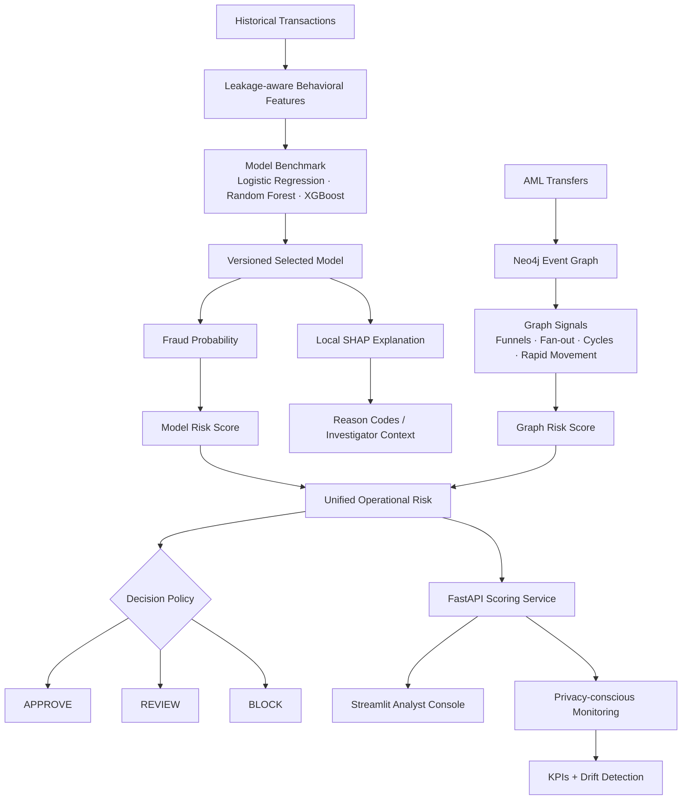
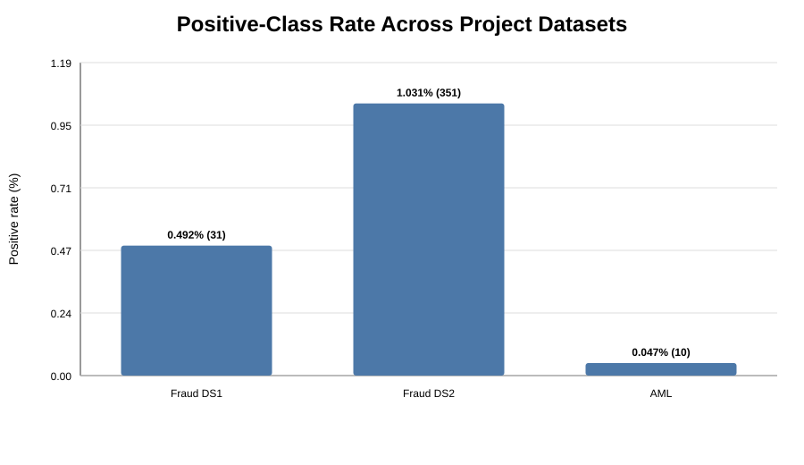
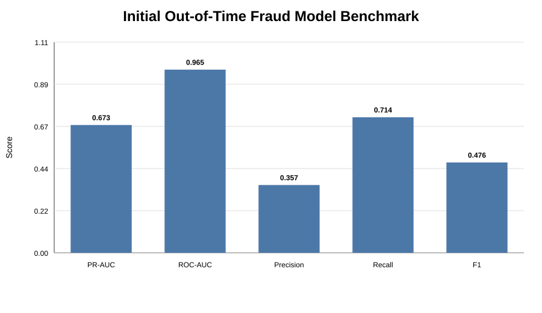
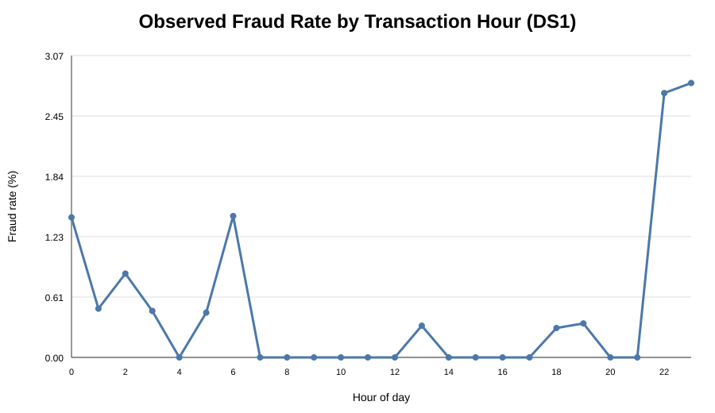
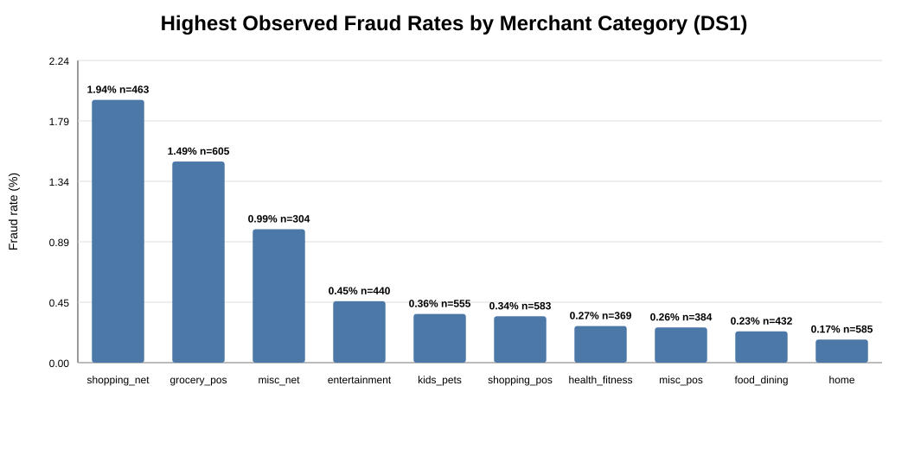

# FraudGraph Intelligence — Financial Fraud & AML Decision Platform

[](https://github.com/Hossain-MD-Rafat/fraudulent_transaction_data_analysis/actions/workflows/tests.yml)


**End-to-end fraud intelligence system combining transaction ML, behavioral analytics, AML graph intelligence, explainability, cost-sensitive decisioning, monitoring, drift detection, an API, and an analyst dashboard.**

> The goal is not just to predict fraud. The platform is designed to **detect, explain, prioritize, and investigate financial risk**.

**Project docs:** [Portfolio summary](docs/PORTFOLIO_SUMMARY.md) · [Phase 3 runbook](docs/PHASE3_PLATFORM.md) · [Data governance](docs/DATA_GOVERNANCE.md)

## At a glance

| Capability | Implementation |
|---|---|
| Transaction fraud ML | Logistic Regression, Random Forest, XGBoost |
| Behavioral intelligence | prior spend, velocity, novelty, temporal and geographic signals |
| Imbalanced evaluation | PR-AUC, recall, precision, F1, ROC-AUC |
| Decision policy | expected fraud exposure + APPROVE / REVIEW / BLOCK |
| Explainability | local SHAP + transparent fallback reason codes |
| AML graph intelligence | Neo4j transfer-event model, funnels, fan-out, cycles, rapid movement |
| Unified risk | transaction-model risk + optional graph risk |
| Serving | FastAPI `/v1/score` and `/v1/decision` |
| Analyst workflow | Streamlit investigation console |
| Governance | versioned feature contract, SHA-256 model integrity checks |
| Monitoring | privacy-conscious JSONL events, KPI summaries, drift checks |
| Reproducibility | Docker, Docker Compose, GitHub Actions |

## Architecture



## Measured model performance

The selected model is **XGBoost**, chosen by validation PR-AUC with the operating threshold selected on validation data only. The newest 15% of transactions is held out until final evaluation.

| Metric | Untouched test result |
|---|---:|
| PR-AUC | **0.673** |
| ROC-AUC | **0.965** |
| Precision | **35.7%** |
| Recall | **71.4%** |
| F1 | **47.6%** |
| Fraud cases detected | **5 / 7** |
| Legitimate alerts | **9** |

The final test window contains only seven fraud events, so the repository also includes **expanding-window temporal backtesting** and avoids treating a single split as proof of production stability.

## Portfolio visuals

<table>
<tr>
<td width="50%"></td>
<td width="50%"></td>
</tr>
<tr>
<td align="center"><b>Rare-event fraud class imbalance</b></td>
<td align="center"><b>Model benchmark comparison</b></td>
</tr>
<tr>
<td width="50%"></td>
<td width="50%"></td>
</tr>
<tr>
<td align="center"><b>Temporal fraud behavior</b></td>
<td align="center"><b>Category-level fraud behavior</b></td>
</tr>
</table>

More saved visuals are available in [`outputs/visualizations/portfolio/`](outputs/visualizations/portfolio/).

## Why the modeling design is realistic

### Leakage-aware behavioral features

Customer/card behavior is computed from **prior transactions only**. Examples include prior mean spend, prior amount standard deviation, time since the previous transaction, 1-hour and 24-hour velocity, prior merchant/category counts, new-merchant/new-category signals, customer-to-merchant distance, and nighttime/weekend behavior.

### Chronological evaluation

```text
oldest                                                    newest
|------------------------|-------------------|-------------------|
          train 70%             validation 15%        test 15%
```

The validation period is used for model comparison and operating-threshold selection. The test period remains untouched until those choices are complete.

### Cost-sensitive decisions

A missed fraudulent transaction and an unnecessary analyst review have different business impact. The decision layer estimates cost using configurable assumptions and produces:

- fraud probability
- model risk score from 0–100
- expected fraud loss (`probability × transaction amount`)
- optional graph risk score
- unified operational risk score
- `APPROVE`, `REVIEW`, or `BLOCK`

## Explainability

For supported packaged pipelines, `/v1/score` returns local SHAP contributions with:

- transformed feature name
- signed SHAP value
- direction toward fraud or toward legitimate behavior

If SHAP is unavailable, the API explicitly falls back to investigator cues such as unusual spend, large geographic distance, high velocity, merchant/category novelty, or nighttime activity. Fallback cues are not represented as SHAP values.

## AML / graph intelligence

Every AML transfer is preserved as its own event node:

```text
(Account)-[:SENT]->(AMLTransfer)-[:RECEIVED_BY]->(Account)
```

This prevents repeated transfers between the same accounts from collapsing into one relationship and enables investigation of:

- laundering-neighbor exposure
- many-to-one funnels
- one-to-many fan-out behavior
- rapid pass-through movement
- circular transfer patterns
- suspicious counterparties

Graph enrichment is **optional and fail-open**: if Neo4j is unavailable, transaction-model scoring still succeeds and reports that graph enrichment was unavailable.

### Governed graph escalation

Network intelligence may **escalate but never downgrade** the model decision.

```text
Graph risk < 60      -> no graph escalation
Graph risk 60–84     -> REVIEW when escalation is required
Graph risk >= 85     -> BLOCK when escalation is required
```

The response exposes both `model_decision` and final `decision`, plus `decision_reason` when the graph layer changes the action. Thresholds are configurable.

## Model governance

Packaged models stay outside Git and include metadata for:

- model version
- feature-contract version
- exact feature order
- validation-selected operating threshold
- benchmark metadata
- SHA-256 model checksum

The service rejects missing, incompatible, or checksum-mismatched artifacts rather than silently loading another model.

## Monitoring and drift

Operational scoring events can be persisted as JSONL containing model/version information, probability, risk scores, final decisions, expected exposure, graph availability, and explanation method.

For privacy, direct transaction IDs are hashed and raw feature payloads are not written to the scoring log. The project also provides numeric PSI drift checks, categorical distribution-distance checks, aggregate-only reference profiles, and operational KPI summaries.

## API

### `GET /health`
Service health information.

### `POST /v1/decision`
Turns an upstream fraud probability into a governed risk decision.

### `POST /v1/score`
Scores the strict `fraud_ds1_features_v1` engineered feature contract with the versioned model and optionally enriches the result with Neo4j network risk.

A score response can contain model version, feature-contract version, fraud probability, model risk, graph risk, unified risk, model decision, final decision, expected fraud loss, reason codes, SHAP contributions, and graph signals.

## Analyst console

The Streamlit investigation console supports portfolio-level risk metrics, review/block queues, expected-exposure prioritization, risk and decision distributions, filters, and single-transaction decision simulation.

## Quick start

```bash
python -m venv .venv
pip install -r requirements.txt
python scripts/benchmark_fraud_models.py
python scripts/package_fraud_model.py
python scripts/smoke_test_packaged_model.py
```

Run locally:

```bash
uvicorn api.main:app --reload
streamlit run dashboard/app.py
```

Or start the application stack:

```bash
cp .env.example .env
docker compose up --build
```

API docs are available at `http://localhost:8000/docs`; the Streamlit console runs at `http://localhost:8501`.

## Repository structure

```text
fraudulent_transaction_data_analysis/
├── api/                         # FastAPI scoring service
├── dashboard/                   # Streamlit analyst console
├── data/                        # raw / cleaned / transformed data
├── docs/                        # production runbook and project docs
├── models/                      # generated locally; Git-ignored
├── outputs/visualizations/      # saved portfolio visuals
├── scripts/                     # training, packaging, graph, drift and utility jobs
├── src/fraud_detection/         # reusable ML/risk/graph/monitoring modules
├── tests/                       # unit and integration-contract tests
├── Dockerfile
├── docker-compose.yml
├── requirements.txt
└── README.md
```

## CI quality gates

GitHub Actions validates three layers:

1. **Unit tests** — feature engineering, risk policy, API contracts, graph logic, monitoring, drift, and artifact integrity.
2. **Real-model smoke test** — benchmark → select XGBoost → package `fraud_ds1_xgb_v1` → checksum validation → reload → score a real transaction.
3. **Docker validation** — Compose configuration validation and complete application image build.

## Project status

- [x] Phase 1 — leakage-aware transaction fraud ML
- [x] Phase 1 — model comparison, cost-sensitive thresholding and SHAP
- [x] Phase 1 — temporal validation
- [x] Phase 2 — AML transfer-event graph redesign
- [x] Phase 2 — graph integrity and investigation queries
- [x] Phase 3 — FastAPI scoring and analyst dashboard
- [x] Phase 3 — model packaging and integrity validation
- [x] Phase 3 — graph enrichment and governed escalation
- [x] Phase 3 — monitoring and drift detection
- [x] Phase 3 — Docker and CI production checks

## Technical stack

**Python · Pandas · scikit-learn · XGBoost · SHAP · Neo4j · Cypher · FastAPI · Streamlit · Docker · GitHub Actions**

## Project principle

> **Build a system that detects, explains, prioritizes, and investigates financial risk — not just a model that predicts fraud.**
